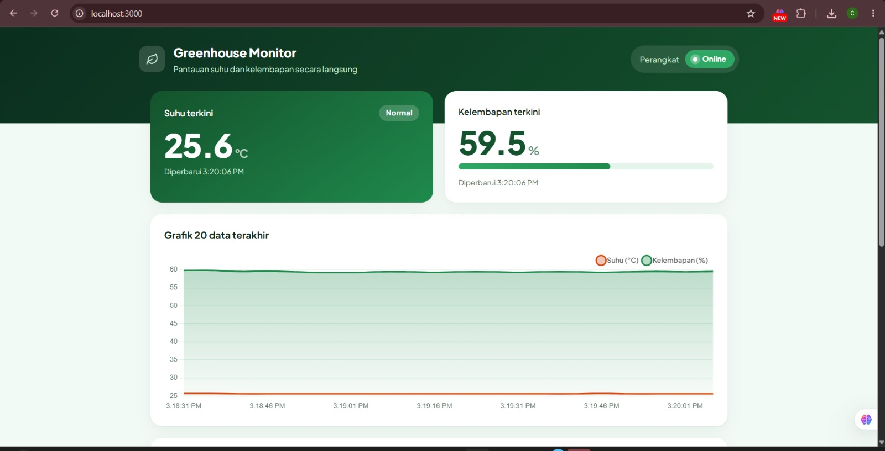
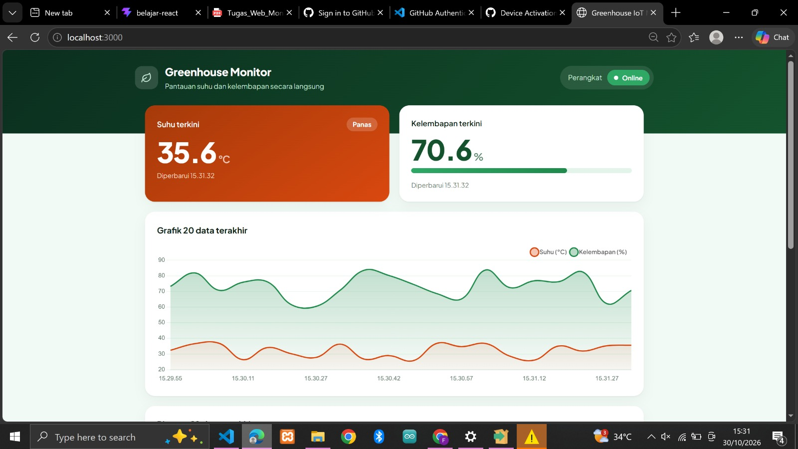
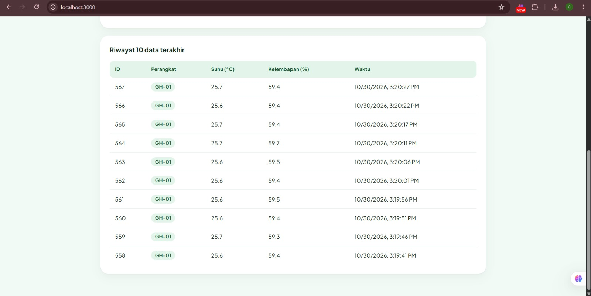
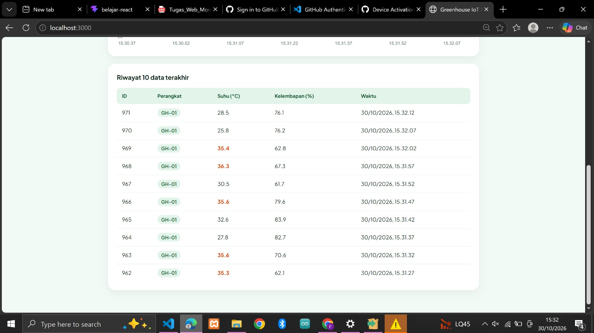
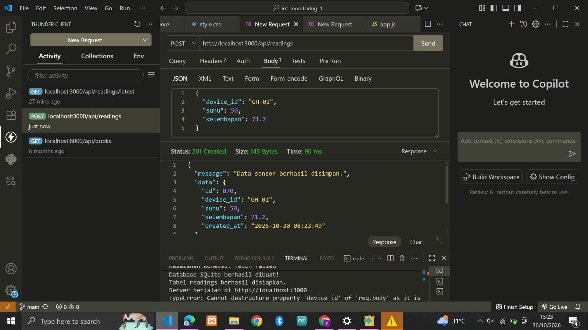
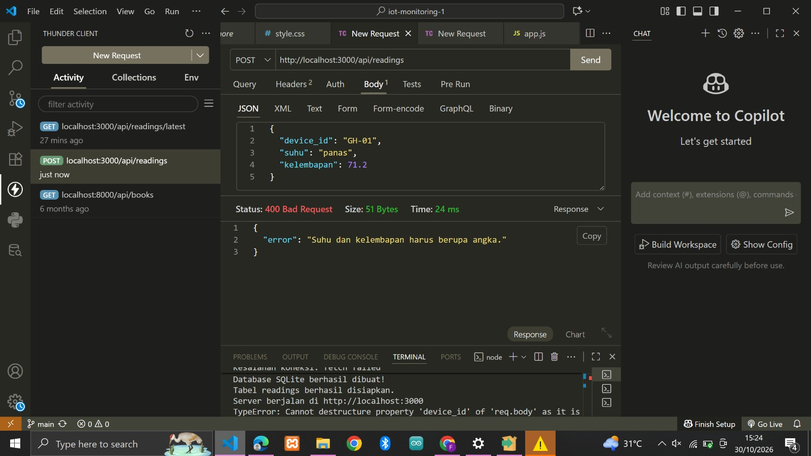
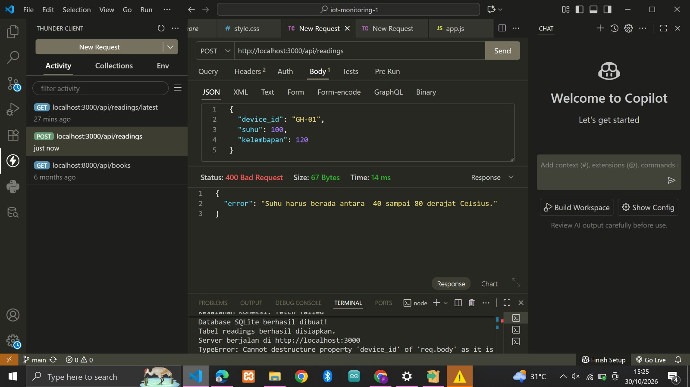
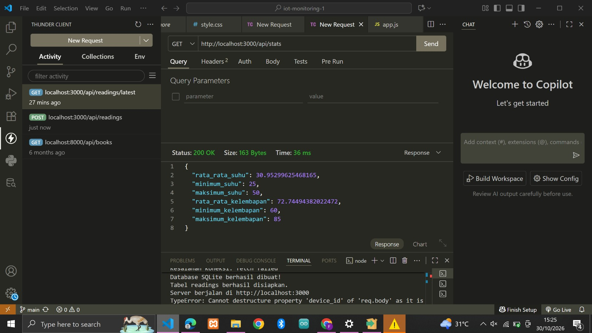
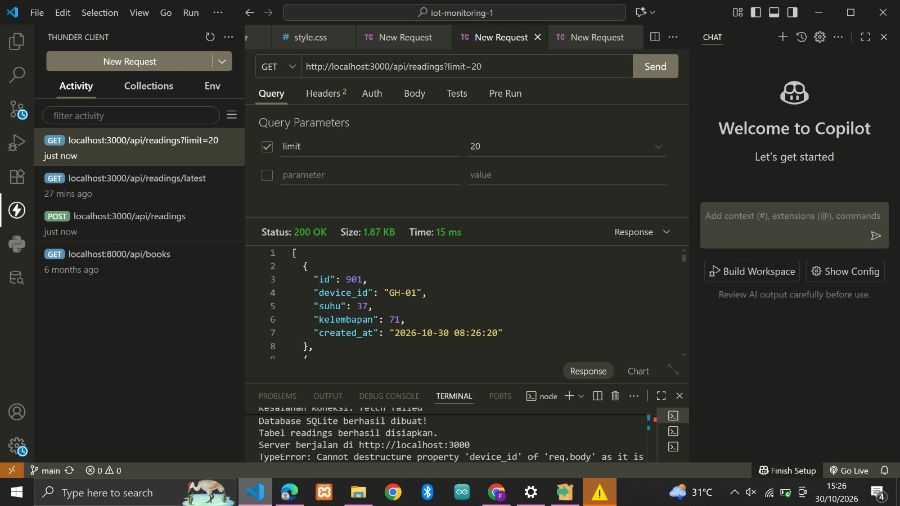
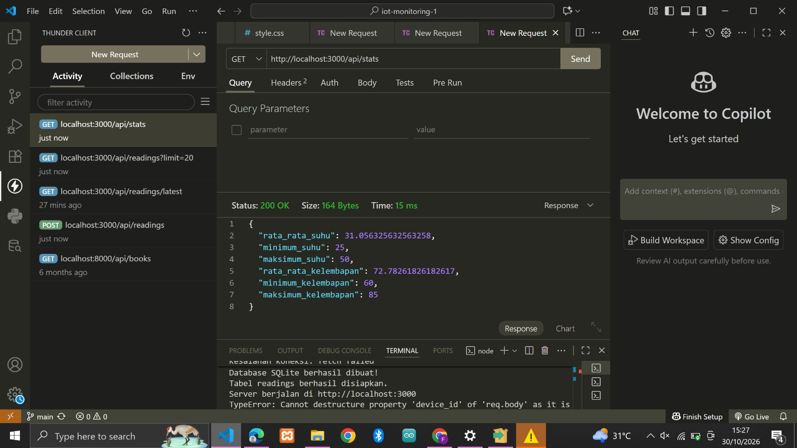

# iot-monitoring-e41241570

Aplikasi web monitoring IoT untuk greenhouse. Perangkat (simulator) mengirim data suhu dan kelembapan setiap 5 detik lewat HTTP POST, backend Express menyimpannya ke SQLite, dan dashboard web menampilkannya secara otomatis (polling setiap 5 detik tanpa reload halaman).

Tugas Praktikum WS Sistem Tertanam, Web Monitoring IoT Full Stack Dev.

## Identitas Kelompok

| Peran | Nama | NIM |
|---|---|---|
| Ketua | Nurul Hidayah | E41241334 |
| Anggota 1 | Priyo Adi Santoso | E41241262 |
| Anggota 2 | Nur Fitri Romadhani | E41241444 |
| Anggota 3 | Celshee Amelia Laila Putri | E41241570 |
| Anggota 4 | Muhammad Dimas Aji Pangestu | E41241612 |

- Kelas: Golongan D
- Repository: [https://github.com/Celsheaamelia/iot-monitoring](https://github.com/Celsheaamelia/iot-monitoring.git) (nama repository memakai NIM E41241570, milik Celshee Amelia Laila Putri)

## Fitur

- Menerima data sensor lewat REST API, dengan validasi (status 400 jika tidak valid).
- Menyimpan data deret waktu ke SQLite (data tetap ada setelah server di-restart).
- Dashboard: kartu suhu dan kelembapan terkini beserta waktu pembaruan, grafik garis 20 data terakhir (Chart.js), tabel riwayat 10 data terakhir, dan statistik rata-rata/min/maks.
- Kartu suhu berubah merah ("Panas") jika suhu > 35 °C, hijau jika normal.
- Indikator status perangkat: Online jika data terakhir < 30 detik, selain itu Offline.
- Simulator perangkat yang mengirim data acak setiap 5 detik dan mencatat respons di console.

## Teknologi

HTML, CSS, JavaScript (fetch + Chart.js via CDN), Node.js + Express, SQLite (`better-sqlite3`), Git/GitHub.

## Prasyarat

- Node.js 22 atau lebih baru (disarankan versi LTS terbaru), sesuai syarat `better-sqlite3` 13. Cek dengan `node -v`.
- Git dan koneksi internet (untuk `npm install` dan memuat Chart.js dari CDN).

## Cara Menjalankan

```bash
# 1. Pasang dependensi
npm install

# 2. Terminal 1: jalankan server, lalu buka http://localhost:3000
node server.js

# 3. Terminal 2: jalankan simulator perangkat
node simulator.js
```

Dashboard akan terisi otomatis begitu simulator mengirim data pertama (maksimal 5 detik). Berkas database `iot.db` dibuat otomatis saat server pertama kali dijalankan. Port dapat diubah dengan variabel lingkungan `PORT`.

## Struktur Folder

```
iot-monitoring-e41241570/
├── public/
│   ├── index.html     # halaman dashboard
│   ├── style.css      # tampilan
│   └── app.js         # fetch API, grafik, polling 5 detik
├── screenshots/       # tangkapan layar dashboard dan uji POST
├── server.js          # REST API (Express)
├── db.js              # koneksi SQLite dan skema tabel
├── simulator.js       # simulator perangkat (pengganti ESP32)
├── package.json
├── package-lock.json
├── .gitignore
└── README.md
```

## Skema Database

Tabel `readings`:

| Kolom | Tipe | Keterangan |
|---|---|---|
| `id` | INTEGER | Primary key, autoincrement |
| `device_id` | TEXT | Kode perangkat, contoh `GH-01` |
| `suhu` | REAL | Suhu dalam °C |
| `kelembapan` | REAL | Kelembapan relatif dalam % |
| `created_at` | TEXT | Waktu simpan (UTC), default `CURRENT_TIMESTAMP` |

## Endpoint REST API

| Method | Endpoint | Fungsi | Respons sukses |
|---|---|---|---|
| POST | `/api/readings` | Menerima data sensor dari perangkat | `201` + data tersimpan |
| GET | `/api/readings/latest` | Data terbaru untuk kartu nilai | `200` + objek JSON (`404` jika belum ada data) |
| GET | `/api/readings?limit=20` | Riwayat N data terakhir (terbaru dulu), default 20, maks 500 | `200` + array JSON |
| GET | `/api/stats` | Rata-rata, minimum, maksimum suhu dan kelembapan | `200` + objek JSON |

### Contoh request

```http
POST /api/readings
Content-Type: application/json

{ "device_id": "GH-01", "suhu": 29.4, "kelembapan": 71.2 }
```

Respons `201`:

```json
{ "id": 1, "device_id": "GH-01", "suhu": 29.4, "kelembapan": 71.2, "created_at": "2026-10-30 06:56:38" }
```

### Validasi (status 400 + pesan JSON)

| Kondisi | Contoh pesan error |
|---|---|
| `device_id` kosong atau bukan teks | `device_id wajib diisi (teks)` |
| `suhu` / `kelembapan` bukan angka | `suhu dan kelembapan harus berupa angka` |
| Suhu di luar -40 s.d. 80 °C | `suhu di luar rentang -40 sampai 80 °C` |
| Kelembapan di luar 0 s.d. 100 % | `kelembapan di luar rentang 0 sampai 100 %` |
| Body bukan JSON valid | `body bukan JSON yang valid` |

## Tangkapan Layar

### Dashboard

**Tampilan utama dashboard**



**Dashboard saat data diperbarui otomatis (real-time)**



**Tabel riwayat 10 data terakhir**



**Tabel riwayat saat data diperbarui otomatis (real-time)**



### Uji endpoint POST (Thunder Client/Postman)

**Uji POST 1**



**Uji POST 2**



**Uji POST 3**



**Uji POST 4**



**Uji POST 5**



**Uji POST 6**



## Catatan

- `created_at` disimpan dalam UTC oleh SQLite; dashboard mengonversinya ke waktu lokal browser.
- Jika `better-sqlite3` gagal terpasang, gunakan paket `sqlite3` sebagai alternatif.
- Berkas `node_modules/` dan `*.db` tidak ikut di-push (lihat `.gitignore`).
